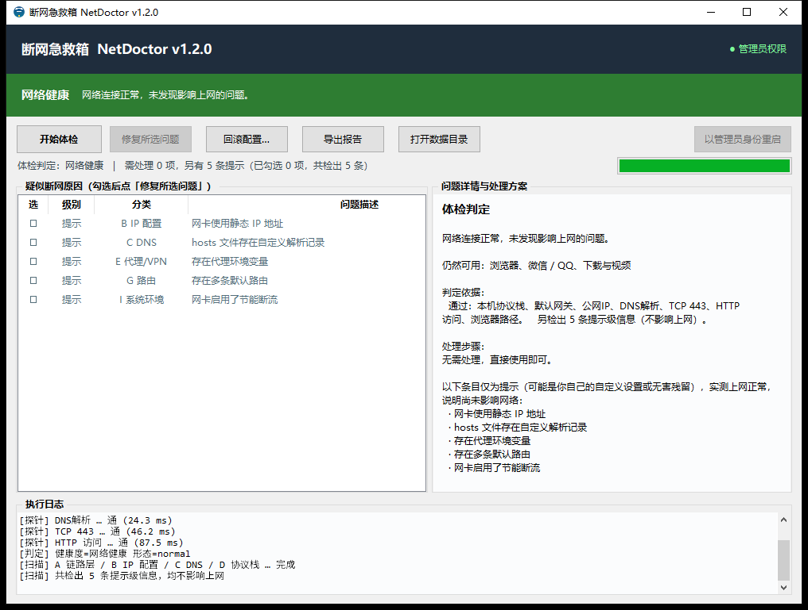
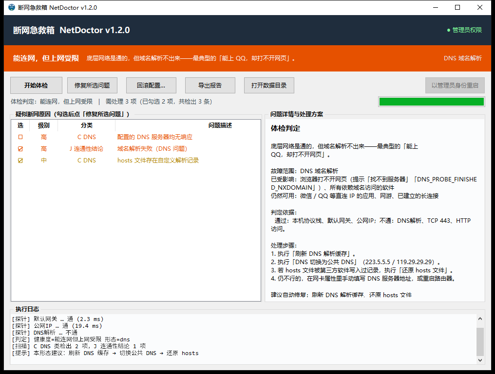

# NetDoctor 断网急救箱

> Windows 断网原因自动诊断与修复工具。**先判定当前网络是否正常、断在哪一环，再列出全部疑似原因** → 备份配置 → 一键修复 → 复测连通性 → 给出结论。

无需安装：从 [Releases](../../releases) 下载 `NetDoctor.exe` 双击即用（修复类操作会请求管理员权限）；
也可以按 [打包](#打包) 一节的说明从源码自行构建。

## 它解决什么问题

电脑突然上不了网时，常见做法是重启、重装驱动、乱改设置，往往越弄越糟。
NetDoctor 把「排查断网」这件事标准化：

0. **先判定是否正常** —— 用分层探针在几秒内给出结论：**网络健康 / 能连网但上网受限 / 完全断网**，
   并指出断在哪一环（协议栈 / 局域网 / 外网出口 / 域名解析 / 端口 / 代理 / MTU / 系统时间）；
1. **只读扫描** —— 遍历 10 大类 40 余项可能导致断网的原因，扫描过程不改动任何设置；
2. **一次性告知** —— 把所有疑似原因列出来，每条都带严重度、判定依据和解决方案；
3. **按形态分别处理** —— 不同故障形态走不同的修复预案（例如「能上 QQ 打不开网页」只需处理 DNS / 代理，
   不必去动网卡），避免瞎折腾；
4. **可回滚修复** —— 选择自动修复前，先把你当前的网络配置完整备份，随时能一键还原；
5. **修复后复测** —— 自动重新检测连通性，并判断「问题已修好但仍不通」的情况，明确告知该找谁。

### 两条体验约定（v1.2.0 起）

- **不用弹窗，结果就在界面里**：判定结论、修复结果、回滚结果、报错全部显示在右侧「详情」区和
  底部状态条。仅保留 3 个「确认」对话框（执行修复、进阶二次确认、回滚），因为它们拦的是会改动
  系统的操作。
- **没有真的上网问题，就只提示、不报警**：健康度**只由实测连通性决定**。既然探针证明当前能正常
  上网，hosts 自定义记录、静态 IP、代理设置、网卡节能这类**可能是你自己设置的**条目就只以
  「提示」级列出，不计入「需处理」，也不自动勾选任何修复动作——避免把好配置改坏。

## 特性

| 能力 | 说明 |
|---|---|
| **体检判定** | 一句话回答「当前能不能上网」，3 档健康度 + 9 种故障形态，各自带处理预案；健康度只由实测连通性决定 |
| **提示级归并** | 实测正常时，hosts/代理/静态 IP/节能等**可能是用户自定义**的条目只做提示，不压低健康度、不自动勾选 |
| 十类扫描 | 链路层 / IP 配置 / DNS / 协议栈 / 代理与 VPN / 系统服务 / 路由 / 防火墙 / 系统环境 / 连通性结论 |
| 分层探针 | 本机协议栈 → 网关 → 公网 IP → DNS 解析 → DNS 服务器 → TCP 443 → HTTP → **浏览器路径** → MTU |
| **浏览器路径实测** | 按系统代理（注册表）实测「浏览器那条路」是否通，**能区分「只是浏览器上不了网」与「整机全断」** |
| 稳健档修复 | 17 个修复动作，分为「稳健档」（可逆、无需重启）与「进阶档」（协议栈/防火墙重置，需二次确认并重启） |
| 强制备份 | hosts、注册表代理设置、IP 配置、路由表、MTU、服务启动类型、网卡电源管理，全部落盘为快照 |
| 一键回滚 | 按备份清单逐项还原，支持选择任意历史备份点 |
| 双形态 | 图形界面（健康度横幅 + 界面内呈现结果，不用结果弹窗）与命令行（任意终端可用、可脚本化、可输出 JSON） |
| 诊断报告 | 每次运行生成 txt + 自包含 HTML 报告（含判定结论卡片），便于留档或发给运维 |

## 快速开始

### 图形界面（推荐给普通用户）



双击 `NetDoctor.exe` → 点「开始体检」→ 顶部横幅几秒内亮出**判定结论** →
程序自动继续完整排查 → 在右侧「详情」区看结论与处理步骤，在左侧列表看全部条目 →
勾选要处理的项目 → 点「修复所选问题」。

程序会先备份配置，再执行修复，最后自动复测，结果同样直接显示在界面里（不弹窗）；
网络健康时不会打扰你，配置类条目只以「提示」级列出。

判定到真实故障时（例如「能上 QQ 却打不开网页」），界面会指出断在哪一环，并给出该形态
专属的处理步骤与建议勾选的修复动作：



### 命令行（任意 Windows 终端可用）

```bat
NetDoctor.exe                            打开图形界面（等同于双击）
NetDoctor.exe --quick                    快速体检：秒级判定网络是否正常、断在哪一环
NetDoctor.exe --scan                     完整扫描并打印诊断结果
NetDoctor.exe --scan --fast              快速扫描（跳过较慢的深度检测）
NetDoctor.exe --fix                      扫描后询问是否修复
NetDoctor.exe --fix --auto               全自动修复（不询问）
NetDoctor.exe --fix --auto --advanced    允许执行进阶修复（协议栈/防火墙重置）
NetDoctor.exe --json -o result.json      输出 JSON，便于脚本消费
NetDoctor.exe --restore                  回滚最近一次修复
NetDoctor.exe --restore 20261016-193000  回滚指定的备份
NetDoctor.exe --report-dir D:\reports    指定报告输出目录
```

退出码：`0` 成功 / `1` 用户取消 / `2` 备份不存在 / `3` 回滚有失败项 / `4` 权限不足。

> 修复类操作需要管理员权限。exe 已内置 UAC manifest，双击或运行时系统会请求提权；
> 若在受限终端里运行，请用管理员身份打开终端后重试。

## 工作流程

```
┌───────────────┐   ┌──────────────────┐   ┌─────────────────┐
│ 0. 快速体检   │ → │ 1. 判定网络是否  │ → │ 2. 全项扫描     │
│   分层探针    │   │    正常/断在哪环 │   │   40 余项只读   │
└───────────────┘   └──────────────────┘   └────────┬────────┘
                                                    ↓
┌─────────────┐   ┌─────────────┐   ┌──────────────┐   ┌─────────────┐
│ 6. 分层复测 │ ← │ 5. 执行修复 │ ← │ 4. 备份配置  │ ← │ 3. 列出问题 │
│             │   │             │   │              │   │ 按形态勾选  │
└──────┬──────┘   └─────────────┘   └──────────────┘   └─────────────┘
       ↓
   ┌───┴────────────────────────────────────────────┐
   │ 通了 → 报告成功 + 备份路径 + 可回滚            │
   │ 不通 → 判断「已修复的项是否失效」              │
   │    ├ 问题已修好但仍不通 → 线路/硬件/运营商     │
   │    │   → 按故障形态给出下一步 + 提示联系专业人员│
   │    └ 问题仍在 → 列出失败项 + 手动指引          │
   └────────────────────────────────────────────────┘
```

## 打包

```bat
python build\build.py            :: 同时产出单文件版与文件夹版
python build\build.py onefile    :: 只出单文件
python build\build.py onedir     :: 只出文件夹版
```

产物：

- `out/dist/onefile/NetDoctor.exe` —— 单文件，拷走即用（首次启动稍慢，部分杀软可能误报）
- `out/dist/onedir/NetDoctor/NetDoctor.exe` —— 文件夹版，启动快、误报少，分发时需整个文件夹

构建依赖：Python 3.10+ 与 `pyinstaller`（`pip install pyinstaller`）。
`build/make_icon.py`（生成图标）与 `build/make_screenshot.py`（生成文档截图）都用标准库实现，
不需要 Pillow。

## 目录结构

```
net-doctor/
├── app.py                     打包入口（开发期可直接运行）
├── netdoctor/                 源码包
│   ├── main.py                统一入口：GUI / CLI 分流
│   ├── cli.py                 命令行界面
│   ├── gui.py                 tkinter 图形界面（含健康度横幅、窗口图标）
│   ├── flow.py                编排层：扫描→备份→修复→复测→结论
│   ├── scanner.py             扫描引擎（A~J 十类检查）
│   ├── diagnose.py            判定引擎：健康度 + 9 种故障形态 + 分形态预案 + 提示级归并
│   ├── probes.py              分层探针（含浏览器路径 / 系统代理实测）
│   ├── netstate.py            网络状态结构化采集
│   ├── fixers.py              修复动作实现
│   ├── backup.py              备份与回滚
│   ├── report.py              诊断报告（txt / html）
│   ├── models.py              数据模型（含 Verdict 判定结论）
│   ├── fixids.py              修复动作 id 常量表
│   └── util.py                命令执行 / 权限 / 日志 / 注册表 / 资源路径
├── build/                     打包脚本、图标与截图生成、版本信息
├── tests/                     判定引擎离线回归测试
├── docs/                      设计说明、判定与故障形态、检查项清单、使用说明
│   └── images/                README 使用的界面截图
├── .github/workflows/ci.yml   CI：语法自检 + tkinter 检查 + 回归测试（不产出二进制产物）
├── out/                       构建产物、报告（未入库）
├── requirements.txt           构建依赖（运行仅需标准库）
├── CHANGELOG.md               更新日志
└── LICENSE                    MIT
```

运行时会在程序所在目录下创建：

- `backups/<时间戳>/` —— 配置备份（含 `manifest.json`）
- `reports/` —— 诊断报告
- `logs/` —— 运行日志

## 自动化

[`.github/workflows/ci.yml`](.github/workflows/ci.yml) 在每次 push / PR / 打 tag 时执行三道质量门禁
（Windows 环境）：

1. `compileall` 语法自检；
2. 显式 `import tkinter` —— 语法检查不会导入模块，缺 tkinter 时打出的 exe 一开界面就崩，
   所以单独确认一次；
3. 判定引擎回归测试。

工作流**不构建、不发布二进制产物**：产物由维护者按上一节 [打包](#打包) 在本地构建后自行分发。
运行程序只需标准库，[`requirements.txt`](requirements.txt) 仅用于本地构建。

## 安全设计

- **扫描零改动**：全部扫描项均为只读探测，不会修改系统设置。
- **先备份后修复**：任何修复动作执行前，配置快照必须落盘成功。
- **动作分档**：`fixids.py` 中区分稳健档与进阶档；进阶档默认不勾选，需二次确认。
- **不依赖高危工具**：注册表读写走 winreg API、服务管理走 WMI/PowerShell，
  不调用 `reg.exe` / `sc.exe`，在被安全策略限制的机器上也能工作。
- **可回滚**：`backups/<会话>/manifest.json` 记录每一项的来源与还原方式。

## 已知限制

- 仅支持 Windows 10 / 11 及以上版本。
- 「网络状态采集」优先使用 PowerShell 的 `NetTCPIP` 模块；在缺少该模块的老系统上自动降级为 `netsh` 文本解析。
- 部分检测项（如上网行为管理、802.1X 准入认证、运营商侧故障）无法从本机判定，工具会明确提示需联系专业人员。
- 判定引擎需要 TCP 443 / HTTP 两层探针参与；`--fast` 模式虽然跳过了一些慢速检查项，但仍会执行这两层（否则无法区分「只有浏览器上不去」与「全断」）。
- 未经代码签名时，个别杀毒软件可能对 PyInstaller 产物误报，建议使用文件夹版或自行签名。
- 重新打包前请确认没有正在运行的 `NetDoctor.exe`，否则产物目录被占用会打包失败。
- 打包脚本把旧的 `onedir` 产物移入 `out/_trash` 而不是直接删除（避免误删难以恢复）。
  该目录可随时手动删除。

## 文档

- [设计说明](docs/设计说明.md) —— 架构、模块职责、数据流、扩展方式
- [体检判定与故障形态](docs/判定与故障形态.md) —— 判定原则、健康度档位、9 种故障形态、提示级条目
- [扫描与修复项清单](docs/扫描与修复项清单.md) —— 全部检查项与修复动作的对照表
- [使用说明](docs/使用说明.md) —— 面向使用者的操作指引与常见问题
- [更新日志](CHANGELOG.md) —— 版本沿革
- 判定引擎回归测试：`python tests/test_diagnose.py`（14 组形态用例 + 提示级行为校验）

## 许可证

[MIT](LICENSE) © 2026 NetDoctor

本工具会读取系统网络配置、并在你确认后执行修复动作，请自行评估使用风险。
